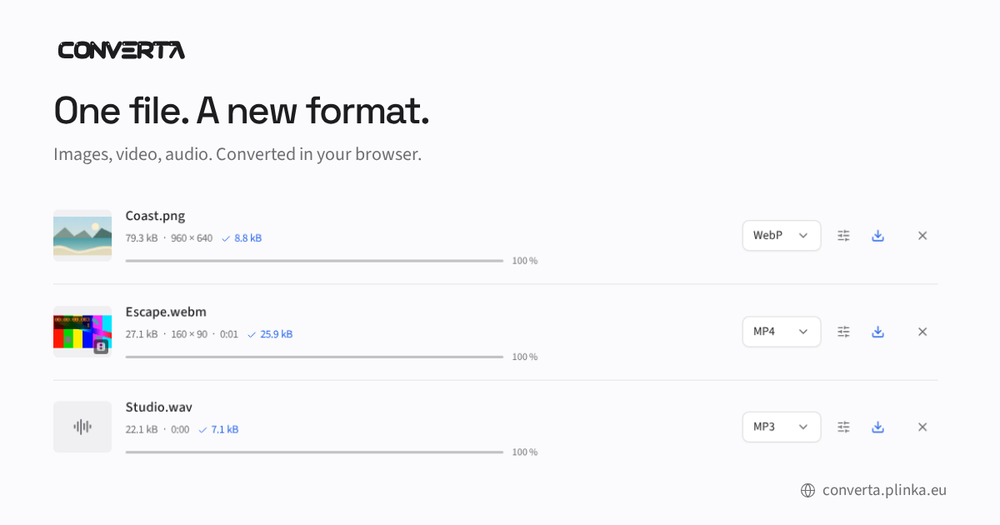

# Converta

L’outil de conversion Plinka. Application statique : images, vidéo et audio sont traités **dans le navigateur**, sans upload, API de conversion ni backend.



## Démarrer en local

Prérequis : Bun **1.4.2**, Node **22.12+** (Node 24 testé).

```sh
bun install --frozen-lockfile
bun run dev
```

Ouvrir **http://127.0.0.1:5500**. Le serveur écoute uniquement sur la machine locale.

```sh
bun run build
bun run preview
```

La version de production est servie sur http://127.0.0.1:5501. `dist/` contient le site statique complet. Le déploiement de production utilise Cloudflare Pages via le workflow GitHub protégé.

## Fonctionnement

- Images : PNG, JPG, WebP, AVIF, GIF fixe, BMP, ICO et TIFF en sortie. Lecture native, complétée par UTIF, libavif/WASM et heic2any ; import SVG autonome avec rasterisation.
- Vidéo : MP4/H.264, WebM/VP9, MOV et MKV. Extraction audio possible.
- Audio : MP3, WAV, M4A/AAC, OGG/Opus et FLAC.
- Compression : qualité des images, côté maximum, qualité vidéo, résolution, cadence, suppression du son, débit audio et mono. Les formats sans perte ne deviennent pas des formats avec perte lorsque l’on change le curseur.
- Lots séquentiels, annulation du worker actif, reprise des erreurs, téléchargement individuel ou ZIP avec noms uniques. Taille et variation de poids affichées après conversion.
- Thèmes système/clair/sombre, wordmark adapté, FR/EN, clavier et mobile.

Mediabunny et WebCodecs sont le chemin principal. Les codecs audio WASM et le moteur FFmpeg de compatibilité sont chargés à la demande. Les binaires proviennent des dépendances installées et sont **servis par ce site**, jamais par un CDN. Les fichiers utilisateurs ne quittent pas le navigateur. Les préférences de langue et de thème sont conservées en `localStorage` ; seul le compteur public GitHub est mis en cache dix minutes en `sessionStorage` ; la file de fichiers reste en mémoire et disparaît au rechargement.

`postinstall` copie le JavaScript FFmpeg et découpe le WASM en deux parties de moins de 25 Mio dans `apps/web/public/engines/`, ignoré par Git mais inclus dans le build. Le téléchargement initial des dépendances nécessite Internet ; les conversions ne dépendent d’aucun service distant. Pour convertir sans connexion, les fichiers de l’application et du moteur choisi doivent déjà être disponibles. Cette version ne possède pas encore de service worker pour une installation hors ligne.

## Limites explicites

- Les GIF, WebP animés et TIFF multipages utilisent la première image ; pas de réencodage d’animation image dans cette version.
- Pas de vectorisation : SVG est une entrée, pas une sortie. Les SVG contenant scripts, contenu actif ou ressources externes sont refusés.
- ICO est limité à 256 px. JPG et BMP utilisent un fond blanc pour les zones transparentes.
- Les encodeurs et décodeurs disponibles varient selon le navigateur et le système. FFmpeg/WASM est le secours vidéo/audio ; un fichier corrompu ou un codec absent peut toujours échouer explicitement. Aucune piste audio/vidéo n’est supprimée silencieusement.
- 40 fichiers par file ; 1 Go par fichier, 100 Mo pour les images, 80 mégapixels décodés. Les résultats et ZIP utilisent la mémoire de l’appareil ; les limites réelles peuvent être inférieures sur mobile.
- HEIC/HEIF dépend des profils compris par le décodeur embarqué ; les captures ne constituent pas une promesse de prise en charge de tous les codecs et profils.

## Architecture et conventions

Référence : [ExtraBinoss/plinka-guidelines](https://github.com/ExtraBinoss/plinka-guidelines), commit `14e574a`, vérifié le 20 octobre 2026.

- `apps/web/src/app` : React, bootstrap du thème avant le premier rendu, i18next et composition.
- `apps/web/src/features/converter` : UI, état Jotai et contrôleur de la file.
- `apps/web/src/adapters` : protocole versionné, workers, canvas, décodeurs et encodeurs.
- `packages/core` : catalogue, noms, dimensions, transitions pures et sérialisation BMP/ICO, compilés sans DOM ni types Node.
- `apps/web/src/components/ui` : composants **générés avec shadcn 4.22.1**, style `base-luma`, **Base UI**, licence MIT. Les adaptations visuelles utilisent les tokens CSS Plinka et ne remplacent pas les comportements des primitives.

React 19, TypeScript strict, Vite 8, Bun, Tailwind 4, Motion, Jotai, i18next/react-i18next et Lucide. Le CSS officiel shadcn 4.22.1 est conservé dans `components/ui/shadcn.css`, avec sa licence : le CLI de génération n’est pas une dépendance de l’application. Source Sans 3 et Space Grotesk sont servies localement. TypeScript 5.9.3 est conservé pour respecter les peer dependencies de typescript-eslint (`<6.1`) ; le registre propose TypeScript 7 à cette date.

La liste utilise Virtua `VList` avec mesure des hauteurs variables et conserve les lignes dont un réglage est ouvert ou un contrôle reçoit le focus. Seules les lignes proches de l’écran sont montées. Les fondus de défilement suivent le débordement réel sans rendu React à chaque scroll ; leur couleur vient de la surface et leur flou se fond dans les actions. Les noms tronqués défilent au survol ou au focus, avec Motion Mini et `transform`, puis reviennent immédiatement au début en quittant le survol. Le mode de réduction des animations est respecté. La progression linéaire utilise `scaleX`.

## Vérification

```sh
bun run typecheck
bun run lint
bun run format:check
bun run test:coverage
bun run build
bunx playwright install chromium firefox
bun run test:browser
```

Les tests navigateur exigent aussi `ffprobe` sur la machine de développement pour vérifier les pistes des fichiers produits. FFmpeg/ffprobe système ne sont **jamais utilisés par l’application**. Les fixtures média sont synthétiques.

La couverture V8 impose 85 % sur les quatre métriques globalement et sur le cœur. Les composants de registre shadcn, dont la logique n’est pas modifiée, sont exclus de la couverture unitaire ; leurs usages sont vérifiés par les tests UI et navigateur. Les simulations DOM désactivent la mise en scène Motion ; les tests navigateur utilisent les vraies animations.

L’audit React Doctor 0.9.18 a été exécuté sans télémétrie ni analyse distante : aucune erreur. Les avertissements restants ont été relus : URL SVG révoquée dans un `finally` testé, exports inchangés de shadcn, branchement des états de ligne et file séquentielle volontaire pour borner la mémoire. Le seuil de couverture a aussi été vérifié avec une source temporaire non exécutée, puis cette source a été retirée.

Les tests réels vérifient les pixels et la transparence, huit encodeurs image, les entrées SVG/TIFF, H.264 et audio après WebM → MP4, le vrai secours FFmpeg pour AVI → MP4, l’export MP3/FLAC/AAC/Opus, la compression par fichier, le ZIP, la poursuite du lot après une erreur, les progressions individuelles, les thèmes et le mobile. La première conversion est également vérifiée avec un cache Vite vide pour détecter les rechargements intempestifs. Les miniatures vidéo sont décodées avec Mediabunny. Chaque fichier affiche sa barre de progression et un anneau avec pourcentage au survol, au focus ou au toucher. Rapports, captures et traces restent dans `artifacts/`, `coverage/` et `test-results/`, ignorés par Git.

## Hébergement statique futur

Le build est prêt pour un hébergeur statique. Conserver les en-têtes COOP/COEP de `public/_headers`, les types MIME JavaScript et WASM et les fichiers `engines/`. Production : **https://converta.plinka.eu**. Dépôt public : **https://github.com/ExtraBinoss/Converta**.

Voir [THIRD_PARTY.md](THIRD_PARTY.md) pour la provenance des composants et codecs.

## Publication

Le workflow `.github/workflows/publish.yml` vérifie types, lint, format, couverture et conversions dans Chromium/Firefox avant de publier l’artefact testé. Le déploiement exige `main`, le dépôt d’origine, l’identifiant GitHub `113912449` et `ExtraBinoss` comme acteur de relance. Les pull requests et forks ne déploient pas.

Le secret `CLOUDFLARE_API_TOKEN` est chiffré dans l’environnement GitHub `production`, limité à `main` et protégé par une approbation de `ExtraBinoss`. `CLOUDFLARE_ACCOUNT_ID` est une variable de cet environnement. Les actions sont verrouillées par SHA. Le jeton possède seulement `Pages Write` sur le compte concerné ; Cloudflare ne propose pas ici une restriction du jeton à un seul projet Pages. Aucun jeton n’est livré au navigateur ou au dépôt. L’environnement Cloudflare n’interprète pas les acteurs GitHub : ce contrôle est appliqué par le workflow et les protections GitHub.

Le bouton GitHub en haut à droite révèle le nombre réel d’étoiles au survol ou au focus, et l’affiche directement sur les appareils sans survol. Il interroge l’API publique GitHub sans authentification, sans transmettre de fichiers. Les conversions ne dépendent pas de cette requête.

## Image de partage

`artwork/social/index.html` compose une carte en anglais de 1 200 × 630 px avec le vrai logo, les fontes et couleurs locales, et une capture de trois fichiers réellement convertis par Converta. Le domaine et une icône globe apparaissent en bas à droite. Les métadonnées Open Graph/Twitter sont présentes dans le HTML initial.

```sh
bun run build
bun run social:render
bun run build
```

Le second build intègre `apps/web/public/social/converta-en.png`. Le script utilise le port 5503 temporairement et conserve la capture de l’interface dans `artwork/social/assets/`. Il ne génère aucune image par IA et ne nécessite aucun service distant. Le mode de démonstration a été retiré du code de l’application.
